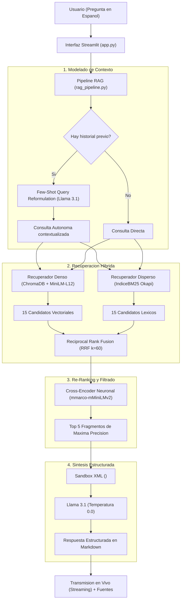

# Caso de Estudio de Ingenieria: Sistema RAG Local para Seguridad en AWS

## Consolidacion y Aplicacion Practica de Competencias en NLP y Arquitectura Cloud

Este documento desglosa en detalle las decisiones de ingenieria, fundamentos teoricos y metodologias de validacion aplicadas en el desarrollo del sistema **AWS Cloud Security RAG Local**. El proyecto fue disenado como caso practico para consolidar y evidenciar las competencias adquiridas en el programa **AWS Academy - Machine Learning for Natural Language Processing (NLP)**, integrando fundamentos de **AWS Academy - Cloud Architecting** y **Cloud Foundations**.

---

## 1. Planteamiento del Problema y Objetivos de Diseno

### El Desafio Tecnico
La documentacion de seguridad en la nube (AWS Security Foundations) es densa, altamente tecnica y predominantemente redactada en ingles. En entornos empresariales y gubernamentales regulados, consultar esta documentacion mediante modelos en la nube (como OpenAI o Anthropic) introduce riesgos de privacidad, costos recurrentes por tokens y dependencia de conectividad externa.

### Requisitos de Arquitectura
1. **Soberania y Privacidad Total (100% Local):** Ningun dato, fragmento o consulta debe salir de la maquina local.
2. **Capacidad Translingue (Cross-Lingual):** Permitir a ingenieros hispanohablantes formular preguntas en espanol y recuperar informacion tecnica precisa indexada originalmente en ingles.
3. **Cero Alucinaciones:** Garantizar que el modelo solo responda basandose en la documentacion oficial suministrada, rechazando cualquier pregunta fuera de alcance con un guardrail estricto.
4. **Alta Fidelidad Lexica y Semantica:** Superar la limitacion comun de los embeddings vectoriales puros, que suelen perder terminos tecnicos especificos, siglas de seguridad y codigos de error.

---

## 2. Matriz de Competencias: Teoria de NLP vs. Implementacion

A continuacion se mapean los conceptos fundamentales de Procesamiento de Lenguaje Natural y Machine Learning con los modulos y funciones concretas implementadas en el codigo fuente:

| Area de NLP / ML | Concepto Teorico | Problema Practico Resuelto | Implementacion en Codigo |
| :--- | :--- | :--- | :--- |
| **Preprocesamiento** | Normalizacion textual, remocion de ruido y segmentacion (*Chunking*) | Los PDFs contienen encabezados, pies de copyright y numeracion en Base-0 que degradan la similitud vectorial. | Funciones `limpiar_texto_pdf()` y `cargar_y_dividir_documentos()` en [rag_pipeline.py](file:///c:/Users/Victus/Desktop/RAG%20local/rag_pipeline.py#L49-L103). Filtro de longitud minima (`MIN_CHUNK_LENGTH = 100`) y `chunk_overlap = 200` (20%). |
| **Embeddings Densos (Bi-Encoder)** | Mapeo de secuencias a un espacio vectorial latente continuo | Necesidad de comprender la intencion semantica de consultas en espanol sobre textos en ingles. | Modelo multilingue `paraphrase-multilingual-MiniLM-L12-v2` integrado con ChromaDB en `crear_o_cargar_vectorstore()` en [rag_pipeline.py](file:///c:/Users/Victus/Desktop/RAG%20local/rag_pipeline.py#L173-L186). |
| **Recuperacion Dispersa (Sparse)** | Ponderacion TF-IDF / Okapi BM25 con normalizacion por longitud de documento | La busqueda vectorial confunde siglas tecnicas cortas (`WORM`, `CloudHSM`, `WAF`) con palabras comunes. | Clase `IndiceBM25` y funcion `tokenizar()` en [rag_pipeline.py](file:///c:/Users/Victus/Desktop/RAG%20local/rag_pipeline.py#L210-L256). Tokenizacion sin acentos y eliminacion de stopwords bilingues. |
| **Fusion de Recuperadores** | Reciprocal Rank Fusion (RRF) | Los puntajes de similitud coseno (rango 0 a 1) y BM25 (escala abierta) no son directamente comparables. | Funcion `fusionar_rrf()` en [rag_pipeline.py](file:///c:/Users/Victus/Desktop/RAG%20local/rag_pipeline.py#L276-L290). Fusiona rankings mediante formula `1 / (k + posicion)` con `k = 60`. |
| **Re-Ranking Neuronal (Cross-Encoder)** | Atencion cruzada conjunta entre consulta y candidato `(query, document)` | Los Bi-Encoders codifican texto por separado y pierden interacciones finas entre terminos. | Modelo `cross-encoder/mmarco-mMiniLMv2-L12-H384-v1` en `reranquear_documentos()` en [rag_pipeline.py](file:///c:/Users/Victus/Desktop/RAG%20local/rag_pipeline.py#L305-L322). |
| **Modelado Conversacional** | Resolucion de correferencias anaforicas en dialogo multi-turno | El usuario hace preguntas de seguimiento ("Cuales son sus ventajas?") que carecen de sujeto para la busqueda. | Cadena `rephrase_chain` con *Few-Shot Prompting* y ventana deslizante (`MAX_HISTORY_MESSAGES = 6`) en [rag_pipeline.py](file:///c:/Users/Victus/Desktop/RAG%20local/rag_pipeline.py#L336-L360). |
| **Alineacion y Guardrails** | Aislamiento contextual y mitigacion de Prompt Injection indirecto | Fragmentos de terceros podrian contener instrucciones maliciosas para forzar alucinaciones. | Delimitacion en `format_docs_xml()` y directivas de presentacion estructurada en [rag_pipeline.py](file:///c:/Users/Victus/Desktop/RAG%20local/rag_pipeline.py#L189-L200) y [rag_pipeline.py](file:///c:/Users/Victus/Desktop/RAG%20local/rag_pipeline.py#L361-L380). |
| **Evaluacion Cuantitativa** | Evaluacion sin sesgo humano con Ground Truth | Medir de forma cientifica si la generacion es fiel y si la recuperacion es exhaustiva. | Evaluador automatizado con **Ragas** en [evaluar_rag.py](file:///c:/Users/Victus/Desktop/RAG%20local/evaluar_rag.py) sobre dataset curado en [dataset_evaluacion.json](file:///c:/Users/Victus/Desktop/RAG%20local/dataset_evaluacion.json). |

---

## 3. Retos de Ingenieria y Descubrimientos Empiricos

Durante el desarrollo y auditoria del sistema se identificaron fenomenos practicos que suelen pasarse por alto en implementaciones RAG basicas:

### Reto 1: La "Ceguera Lexica" de la Busqueda Vectorial Pura
Al evaluar la base vectorial de 436 fragmentos con el modelo `paraphrase-multilingual-MiniLM-L12-v2`, se detecto que consultas como `"Que es WORM en Amazon S3?"` o `"Para que sirve CloudHSM?"` no recuperaban los documentos correctos dentro del top 15:
- **Causa:** El espacio latente del embedding mapea `WORM` de forma cercana a conceptos genericos de almacenamiento o insectos, diluyendo la relevancia frente a parrafos que repiten terminos comunes como "Amazon S3".
- **Solucion implementada:** Se desarrollo un motor de busqueda hibrida en dos etapas:
  1. *Etapa 1 (Recuperacion Amplia):* Se extraen 15 candidatos vectoriales y 15 candidatos lexicos con `IndiceBM25`.
  2. *Etapa 2 (Consenso y Re-Ranking):* Se fusionan con Reciprocal Rank Fusion y se re-ordenan con el Cross-Encoder.
- **Resultado comprobado:** Se preservo una precision del 100% en conceptos generales al tiempo que se rescato la recuperacion de acronimos criticos (`test_integracion_hibrida_rescata_acronimos_que_vectorial_pierde` en [test_rag.py](file:///c:/Users/Victus/Desktop/RAG%20local/test_rag.py#L508-L532)).

### Reto 2: Meta-Lenguaje en Respuestas Generativas
Inicialmente, al inyectar el contexto delimitado como `<documento id="1" fuente="data/Module_7...pdf" pagina="23">`, el modelo Llama 3.1 comenzaba la respuesta citando literalmente:
> *"Segun el documento con id 1 y fuente data/Module_7... en la pagina 23..."*

- **Impacto:** Experiencia de usuario deficiente y respuesta en formato de parrafo plano redundante.
- **Solucion implementada:** Se rediseño el prompt de sistema en [rag_pipeline.py](file:///c:/Users/Victus/Desktop/RAG%20local/rag_pipeline.py#L361-L380), estableciendo pautas explicitas de formateo en Markdown (Definicion General, Capacidades Clave y Casos de Uso en vinetas) y prohibiendo explicitamente el meta-lenguaje de etiquetas de origen, delegando la trazabilidad de fuentes al panel interactivo de la interfaz web.

### Reto 3: Concurrencia e Ingesta Dinamica sin Bloqueo de SQLite
En sistemas basados en ChromaDB / SQLite sobre Windows, re-indexar o subir un PDF mientras la aplicacion web esta activa genera errores de bloqueo (`PermissionError: [WinError 32]`).
- **Solucion implementada:**
  1. En [ingestar_datos.py](file:///c:/Users/Victus/Desktop/RAG%20local/ingestar_datos.py#L13-L27) se implemento un mecanismo de vaciado en caliente (`vs_existente.delete_collection()`) que no requiere eliminar el archivo del sistema operativo.
  2. En [rag_pipeline.py](file:///c:/Users/Victus/Desktop/RAG%20local/rag_pipeline.py#L120-L170) se agrego `procesar_y_agregar_pdf()`, que valida firmas binarias (`%PDF-`), previene *Path Traversal*, elimina duplicados del archivo previo (`where={"source": ruta}`) y reconstruye automaticamente el indice BM25 en memoria cuando cambia el conteo total de fragmentos.

---

## 4. Diagrama de Arquitectura de Informacion

El siguiente diagrama ilustra el flujo de ejecucion desde que el usuario emite una consulta hasta la entrega estructurada de la respuesta:

---

## 5. Metodologia de Evaluacion y Aseguramiento de Calidad

Para validar el sistema no solo de forma cualitativa sino bajo estandares formales de la industria, se establecieron dos capas de evaluacion:

### A. Evaluacion Metodologica con Ragas
El script [evaluar_rag.py](file:///c:/Users/Victus/Desktop/RAG%20local/evaluar_rag.py) ejecuta una bateria de pruebas sobre un conjunto de preguntas y respuestas de referencia (*Ground Truth*) en [dataset_evaluacion.json](file:///c:/Users/Victus/Desktop/RAG%20local/dataset_evaluacion.json):
- **Context Precision:** Evalua si los fragmentos relevantes aparecen en los primeros puestos del ranking.
- **Context Recall:** Mide si el contexto recuperado contiene toda la informacion necesaria para responder la pregunta frente al Ground Truth.
- **Faithfulness (Fidelidad):** Evalua si cada afirmacion de la respuesta generada se puede inferir directamente del contexto provisto (tasa de no-alucinacion).
- **Answer Relevancy:** Evalua si la respuesta responde directamente a lo preguntado sin divagaciones.

### B. Suite de Calidad de Software QA (49 Tests Automatizados)
En [test_rag.py](file:///c:/Users/Victus/Desktop/RAG%20local/test_rag.py) se estructuro una suite ejecutable bajo el framework estandar de QA:
1. **Pruebas Unitarias:** Sanitizacion de entradas, limpieza de texto, tokenizacion BM25 y logica RRF de forma aislada.
2. **Pruebas de Integracion:** Enlace de Embeddings con ChromaDB, carga de Cross-Encoder real, recarga de BM25 en caliente tras subida de PDFs y sincronizacion de contratos entre modulos.
3. **Pruebas de Sistema (E2E) y Aceptacion (UAT):** Flujos multi-turno completos con Llama 3.1 en vivo verificando resolucion anaforica y rechazo estricto por guardrail anti-alucinaciones.
4. **Pruebas de Caja Blanca y Caja Negra:** Analisis de cobertura de ramas condicionales y analisis de valores limite (0, 1, 1000 y 1001 caracteres).
5. **Pruebas No Funcionales:** Latencia de busqueda (< 0.5s), concurrencia (15 peticiones simultaneas en hilos paralelos), resistencia a Prompt Injection indirecto y compatibilidad UTF-8 en Windows.
6. **Pruebas de Mantenimiento:** Pruebas de Humo (*Smoke Tests*), confirmacion de correccion de bugs y no-regresion.
7. **Pruebas de Soporte Bilingue:** Validacion de respuestas de validacion segun idioma (ES/EN), recuperacion estructurada en ingles y activacion del guardrail anti-alucinaciones en ingles.

---

## 6. Conclusiones y Aprendizaje Consolidado

El desarrollo de este sistema demuestra que:
1. **Un RAG de produccion requiere mas que un simple Bi-Encoder:** La combinacion de representaciones densas y dispersas (Hibrida + BM25) junto con un Re-Ranker neuronal es fundamental para alcanzar niveles de precision aceptables en dominios tecnicos especializados.
2. **La soberania de datos es tecnicamente viable:** Es posible ejecutar un sistema de inteligencia artificial generativa con recuperacion semantica avanzada de forma 100% local en hardware estandar, sin comprometer datos confidenciales ni incurrir en costos de suscripcion o APIs externas.
3. **El rol del ingeniero de NLP es integral:** Abarca desde la comprension linguistica profunda (morfologia, lematizacion, anáforas y similitud semantica) hasta el diseno de arquitectura de software, seguridad de la informacion y evaluacion sistematica.
